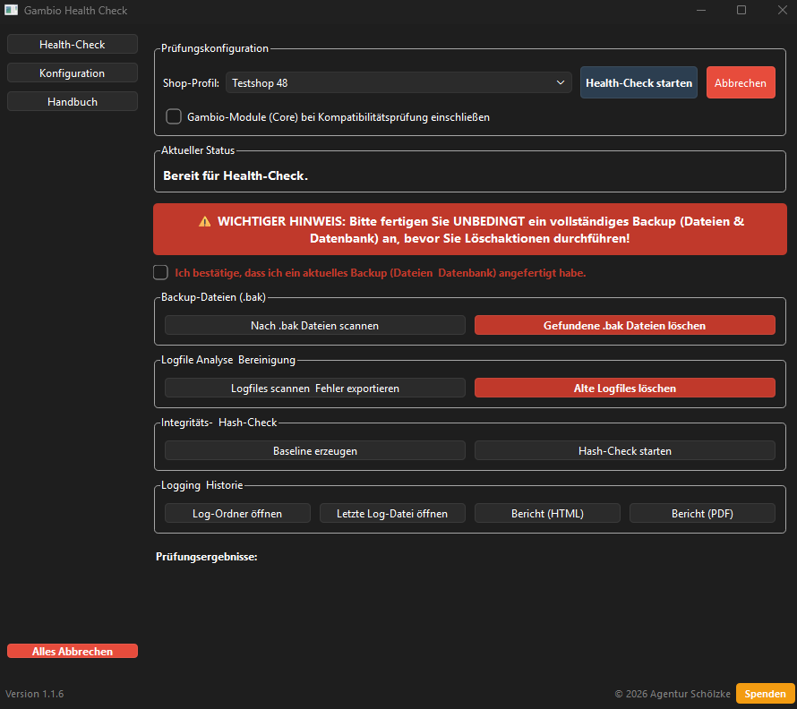

# Gambio Health Check

Ein leistungsstarkes, lokal ausgeführtes Desktop-Werkzeug zur Überprüfung der Systemintegrität und Update-Vorbereitung für Gambio-Shopsysteme.

<p align="center">
  
</p>

## 1. Projektübersicht

Der **Gambio Health Check** unterstützt Shopbetreiber, Agenturen und Entwickler dabei, Gambio-Installationen proaktiv zu überwachen und reibungslose Update-Prozesse zu gewährleisten.

Im Gegensatz zu Cloud-basierten Lösungen arbeitet dieses Tool vollständig **lokal**. Sensible Zugangsdaten werden ausschließlich verschlüsselt auf Ihrem System gespeichert und niemals an externe Server übertragen.

### Hauptzweck
*   **Prävention:** Erkennung von Inkonsistenzen in der Dateistruktur oder Datenbank vor dem Auftreten von Fehlern.
*   **Update-Sicherheit:** Analyse der Systemvoraussetzungen und Kompatibilitäten für anstehende Gambio-Updates.
*   **Datenschutz:** Sichere Verwaltung von Server-Profilen und Passwörtern.

## 2. Features

*   **Health-Check:** Modulare Prüfung von Dateiberechtigungen, Server-Konfigurationen, PHP/MySQL-Versionen und Datenbank-Integrität.
*   **Datei-Integritätsprüfung (Baseline Hashing):** Erstellt rekursiv Hashes aller Shop-Dateien, um unbefugte Änderungen (z.B. Malware) zu erkennen. Folgende Ausnahmen werden beim Hashing automatisch ignoriert:
    * *Verzeichnisse:* `images`, `cache`, `logs`, `export`, `import`, `backups`, `uploads`, `node_modules`, `.git`
    * *Dateitypen:* `.pdf`, `.png`, `.jpg`, `.jpeg`, `.gif`, `.bmp`, `.svg`
    * *Individuelle Ausnahmen:* Über die Einstellungen können benutzerdefinierte Dateien und Ordner/Pfade vom Scan ausgeschlossen werden.
*   **Performance-Optimiert:** Auch bei sehr großen Shops mit 50.000+ Dateien bleibt das Programm durch optimierte I/O-Zugriffe und reduzierte UI-Updates beim Baseline-Erstellen und Hash-Check voll reaktionsfähig.
*   **Update-Analyse:** Tiefenprüfung der Kompatibilität für bereitstehende Updates (PHP, MySQL, Shop-Version) inkl. Prüfung auf Vollständigkeit.
*   **Plugin-Kompatibilitäts-Scan:** Analysiert das `/GXModules`-Verzeichnis über einen Abstract Syntax Tree (AST) Scanner auf Drittanbieter-Module mit veraltetem Code (z. B. alte PHP 4-Konstruktoren, entfernte PHP 8-Funktionen). Core-Module können ausgeklammert werden. Falls `phply` nicht installiert oder nicht korrekt initialisiert ist, wechselt der Scanner automatisch in den robusten Regex-Fallback-Modus.
    > **Wichtig:** Ein Fund bedeutet nicht zwingend einen fatalen Fehler. Es kann sich um ungenutzten (toten) Code handeln. Durch den AST-basierten Scan werden False Positives (z. B. Methoden mit identischem Namen wie veraltete Funktionen) jedoch bereits weitestgehend eliminiert. Falls eine Datei jedoch Syntaxfehler enthält und nicht analysiert werden kann, wird auf einen Text-Scan zurückgegriffen.
*   **Backup-Datei Scanner:** Asynchrone Suche nach potenziell unsicheren `.bak`-Dateien auf dem Server, um alte Code-Stände oder Konfigurationen aufzuspüren und sicher zu entfernen.
*   **Logfile Scanner & Cleanup:** Analysiert Logfiles auf kritische Fehler (z.B. "ERROR", "FATAL") mit Exportfunktion für den Gambio-Support und bereinigt alte Logfiles automatisch nach konfigurierbarem Alter.
*   **Altlasten-Bereinigung:** Intelligente Analyse und sicheres Löschen verwaister Dateien **und Ordner** aus alten Update-Paketen. Der Check erkennt jetzt zuverlässig sowohl Dateien mit Extension als auch Ordner ohne Extension in `to_delete.php` und prüft deren Existenz über FTP/SFTP (mit NLST-Fallback für Ordner).
    > **Sicherheitsmechanismus (Backup-Zwang):** Um versehentliche Datenverluste zu vermeiden, müssen Anwender über eine Checkbox explizit bestätigen, dass ein aktuelles Backup (Dateien und Datenbank) angefertigt wurde, bevor Löschfunktionen freigeschaltet werden.
*   **Whitelist-System:** Konfigurierbare Liste für Dateien, die niemals automatisch gelöscht werden dürfen (z.B. `paypal3.php`).
*   **Verschlüsselte Konfiguration & Profil-Verwaltung:** Speicherung von Shop-Profilen in einer gesicherten AES-verschlüsselten Datei mit atomarem Schreibzyklus, automatischer Bereinigung temporärer Dateien im Fehlerfall, Typvalidierung und Abwärtskompatibilität durch automatisches Default-Merging. Die getroffene Profil-Auswahl bleibt auch bei Neustarts der Anwendung und Seitenwechseln (z. B. zur Konfiguration) dauerhaft erhalten. Zur einfachen Überprüfung hinterlegter Zugangsdaten kann das Passwort über eine Schaltfläche („Anzeigen“ / „Verbergen“) im Klartext eingeblendet werden.
*   **FTP über TLS (FTPS) & gehärteter Klartext-Fallback:** Standardmäßig wird bei FTP-Verbindungen zwingend eine sichere Verbindung via `FTPS` (`FTP_TLS` mit Datenkanal-Verschlüsselung `PROT P`) erzwungen. Schlägt der TLS-Handshake fehl, wird ein unverschlüsselter Klartext-Fallback aus Sicherheitsgründen standardmäßig blockiert (`InsecureFTPError`). Über eine explizite Option im Shop-Profil („Unverschlüsseltes FTP (Klartext-Fallback) erlauben“) kann der Anwender bei Bedarf Legacy-Server autorisieren. Unterstützung von dynamischen PASV-IPs bei Cluster- und Webhosting-Servern (`trust_server_pasv_ipv4_address`).
*   **Strukturiertes Core-Subsystem:**
    * `core.hash_engine.HashCheckEngine`: Robuste Hash-Berechnung (SHA-256) über FTP/SFTP, UTF-8-Encoding, Directory-Traversal-Schutz und Malware-Heuristiken.
    * `core.logger.HealthCheckLogger`: Thread-sicheres JSON-Lines-Logging mit Profil-Isolation, Path-Traversal-Schutz (`pathlib.Path.resolve()`) und Context-Manager-Unterstützung (`with HealthCheckLogger(...)`).
    * `core.reporting`: Export strukturierter HTML- und PDF-Berichte mit robuster Entkopplung (`load_log_entries`), DoS-Begrenzung (`MAX_REPORT_ENTRIES`), strikter Content-Security-Policy (`default-src 'none'`), durchgängigem XSS-Escaping (`html.escape`), Statistik-Karten und Status-Farbcodierung.
*   **Moderne GUI & UI-Architektur:** Benutzerfreundliche Oberfläche basierend auf **PySide6** mit vollständiger Service-Modularisierung:
    * `ui.network_service.NetworkService`: Zentralisiert die Netzwerk- und Protokoll-Logik (FTP/FTPS/SFTP), Verbindungstests, Gambio-Versionserkennung und Ressourcenfreigabe.
    * `ui.network_service.RemoteFileService`: Kapselt rekursive Remote-Operationen (sicheres Löschen von Dateien/Ordnern, Cache-Bereinigung, `.bak`-Suche, Logfile-Leseoperationen).
    * `ui.workers`: Eigenständiges Modul für alle `QThread`-Hintergrund-Worker (`HealthCheckWorker`, `LegacyDeleteWorker`, `BakFileScannerWorker`, `LogfileWorker`), entkoppelt von der GUI-Ebene für maximale Testbarkeit.
    * `ui.dialogs`: Vollständig typisierte Dialoge für Master-Passwort-Abfrage, Shop-Profil-Verwaltung mit automatischer Port-Anpassung je Protokoll (FTP/SFTP/HTTPS), Eingabevalidierung sowie modale Fehler-, Info- und Bestätigungsdialoge (`ask_confirmation`).
    * `ui.backup_manager.BackupManager`: Lokales ZIP-Backup-Management mit atomarer Archivierung, Metadaten-Auflistung, Zeitstempeln und striktem Schutz vor Directory Traversal und Zip-Slip-Attacken (`pathlib.Path.resolve()`).
    * `ui.backup_actions.BackupActions`: Sichere Download-Routinen zur Vorab-Sicherung entfernter Dateien vor Bereinigungsaktionen.
    * `ui.main_window.open_path`: Plattformübergreifendes Öffnen von Verzeichnissen und Berichten mit Path-Traversal-Absicherung.
*   **Security-Logging:** Zentrales Modul [logging_config.py](file:///c:/E/python/Health-Check-Modul/logging_config.py) mit performanten vorkompilierten Regex, idempotentem Setup und `SensitiveFilter` bzw. `sanitize_sensitive_data()`, das formatierte Log-Records und URL/JSON-Secrets (Passwörter, Tokens, Keys) vor dem Schreiben zuverlässig maskiert.
*   **Plugin-Architektur:** Einfache Erweiterbarkeit für individuelle Prüfroutinen.

## 3. Sicherheit

Sicherheit steht bei diesem Tool an erster Stelle:
*   **Schlüsselableitung:** Verwendung von **PBKDF2-HMAC-SHA256** mit 600.000 Iterationen (OWASP-Standard) zur Erzeugung kryptographischer Schlüssel aus dem Masterpasswort.
*   **Verschlüsselung:** Einsatz von **Fernet (AES-128 im CBC-Modus mit HMAC-Authentifizierung)** für Konfigurationsdateien sowie nativer **AES-256-GCM (Galois/Counter Mode)** mit 96-Bit Nonces und AAD-Unterstützung für hochsensible Daten und API-Keys.
*   **CSPRNG-Zufallsgenerierung:** Erzeugung aller kryptographischen Salts und Nonces ausschließlich über Pythons hardware-gestütztes `secrets`-Modul (kein Pseudozufall via `random`).
*   **Brute-Force-Schutz:** Exponentielle Zeitverzögerung bei falschen Passworteingaben (2s bis 32s) und automatischer Lockout nach 10 Fehlversuchen über [security/master_password.py](file:///c:/E/python/Health-Check-Modul/security/master_password.py).
*   **Kein Klartext:** Passwörter werden niemals im Klartext auf der Festplatte gespeichert oder geloggt. Beim Löschen (`clear()`) bzw. Session-Ablauf wird der Speicherbereich im RAM explizit überschrieben und dereferenziert.
*   **Session-Lock & Aktivitätsüberwachung:** Automatischer Timeout-Schutzmechanismus (`SessionLock`), der nach konfigurierbarer Inaktivität sperrt, sensible Daten aus dem Speicher entfernt und Methoden zur Restzeitabfrage (`remaining_seconds()`) bietet. Alle Dateipfade werden strikt über `pathlib.Path.resolve()` gegen Path Traversal abgesichert.
*   **FTP-Klartext-Schutz & TLS-Erzwingung:** Blockierung unverschlüsselter FTP-Fallbacks standardmäßig (`InsecureFTPError`); gezielte Absicherung und Freigabe nur bei expliziter Nutzerkonfiguration im Shop-Profil.
*   **Strukturierte Ausnahmehierarchie:** Modulare Exception-Struktur in [security/exceptions.py](file:///c:/E/python/Health-Check-Modul/security/exceptions.py) (`SecurityError`, `AuthenticationError`, `CryptoError`, `KeyDerivationError`, `EncryptionError`, `DecryptionError`, `InsecureFTPError`, `IntegrityError`, `InvalidMasterPasswordError`, `TooManyFailedAttemptsError`, `SessionExpiredError`) mit typisierten Details, Standardmeldungen und vollständiger Abwärtskompatibilität.
*   **DoS-Schutz bei Berichten:** Pufferbegrenzung (`deque(maxlen=10_000)`) und fehlertolerantes UTF-8-Lesen (`errors="replace"`) verhindern Memory-Exhaustion und Parser-Abstürze bei überdimensionierten oder beschädigten Log-Dateien.

## 4. Installation

### Voraussetzungen
*   **Python 3.10** oder höher.
*   **pip** (Python Package Installer).

### Abhängigkeiten installieren
Klonen Sie das Repository und installieren Sie die benötigten Bibliotheken:

```bash
pip install -r requirements.txt
```

### Anwendung starten
Starten Sie das Tool über die Hauptdatei im Hauptverzeichnis:

```bash
python app.py
```

*Hinweis für Linux-Nutzer:* Stellen Sie sicher, dass Sie über die entsprechenden Berechtigungen für den Zugriff auf lokale Konfigurationsdateien verfügen.

## 5. Projektstruktur

```text
Health-Check-Modul/
├── app.py                    # Einstiegspunkt der Anwendung
├── config/
│   └── config_manager.py     # Logik für verschlüsseltes Speichern/Laden
├── core/
│   ├── __init__.py           # Paket-Exporte (HashCheckEngine, HealthCheckLogger, Reports)
│   ├── hash_engine.py        # Datei-Integrität, Baseline- und Update-Hashing
│   ├── logger.py             # Profilbezogenes JSON-Lines Logging mit Context-Manager
│   └── reporting.py          # HTML- und PDF-Berichtsgenerierung (XSS-geschützt)
├── security/
│   ├── crypto.py             # Kryptographische Operationen
│   ├── exceptions.py         # Sicherheitsspezifische Fehlermeldungen (inkl. InsecureFTPError)
│   └── master_password.py    # Masterpasswort- & Session-Management
├── ui/
│   ├── __init__.py           # Paket-Exporte (MainWindow, Pages, Workers, NetworkService, BackupManager)
│   ├── backup_actions.py     # Remote-Download & Vorab-Sicherung über FTP/SFTP
│   ├── backup_manager.py     # Lokale ZIP-Archivierung mit Zip-Slip- & Path-Traversal-Schutz
│   ├── dialogs.py            # Typisierte GUI-Dialoge (MasterPassword, ShopProfile, Alerts)
│   ├── hc_php_version_check.php # PHP-Helper für Server-Versionsprüfung
│   ├── main_window.py        # Hauptfenster, Navigation & Seiten
│   ├── network_service.py    # NetworkService & RemoteFileService (TLS, Verbindung, Datei-Ops)
│   └── workers.py            # QThread-Hintergrund-Worker (HealthCheck, Delete, BakScan, Logfile)
├── tests/                    # Automatisierte Tests (pytest)
├── logging_config.py         # Logging-Setup mit Sensitive-Filter
└── README.md
```

## 6. Screenshots (Platzhalter)

*   **Login-Dialog:** [Hier Screenshot einfügen: Abfrage Masterpasswort]
*   **Hauptfenster:** [Hier Screenshot einfügen: Übersicht Health-Checks]
*   **Konfigurationsseite:** [Hier Screenshot einfügen: Verwaltung Shop-Profile]

## 7. Entwicklung

### Neue Checks hinzufügen
Die Architektur erlaubt das einfache Hinzufügen neuer Prüfungen. Erstellen Sie dazu ein neues Modul innerhalb der Logik-Ebene und binden Sie es in die `HealthCheckPage` ein.

### Tests ausführen
Das Projekt nutzt `pytest` für die Qualitätssicherung.

```bash
# Alle Tests
pytest tests/ -v --tb=short

# Nur Quality-Gate-Tests
pytest tests/test_quality_gate.py -v
```

### Pre-Commit-Hooks & Code-Qualität

Um automatische Prüfungen bei jedem Git Commit durchzuführen:

```bash
# Pre-Commit Hooks im Git Repository aktivieren
pre-commit install

# Manuelle Ausführung auf allen Dateien
pre-commit run --all-files
```

Folgende automatische Prüfungen sind aktiv:
* **Standard-Checks:** Trailing Whitespace, End-of-File, YAML-Syntax, Large Files, Python-AST-Syntax, Case-Conflicts, Merge-Conflicts, Debug-Statements (z. B. `breakpoint()`), Private Key Detection.
* **Ruff:** Statische Code-Analyse & Formatierung (`ruff` mit `--fix` und `ruff-format`).
* **Bandit:** Sicherheitsanalyse.
* **Pytest:** Automatischer Lauf aller Unit-Tests.

### Build-Prozess & Quality Gate

Der Build-Prozess startet über `build.py` und durchläuft vor jeder Kompilierung
vier sequentielle Sicherheits- und Qualitätsphasen:

| Phase | Tool | Zweck | Abbruchkriterium |
|-------|------|-------|------------------|
| 0 | `pre-commit` | Code-Stil (Ruff), Security (Bandit), Pytest | Formatierungs- / Lint- / Test-Fehler |
| 1 | `pip-audit` | CVE-Scan aller Abhängigkeiten | verwundbare Pakete gefunden |
| 2 | `bandit -lll -iii` | Statische Code-Analyse | HIGH-Severity + HIGH-Confidence Fund |
| 3 | `pytest tests/` | Unit-Test-Suite | mind. 1 fehlgeschlagener Test |

Schlägt eine Phase fehl, wird der Build **sofort** mit Exit-Code 1 abgebrochen.
Erst wenn alle Phasen `✓ OK` melden, startet Cython + PyInstaller.

```bash
# Build starten (inkl. Quality Gate)
python build.py

# Optionen für build.py:
#   --skip-quality-gate   Überspringt das Quality Gate (für lokale Schnelltests)
#   --non-interactive     Deaktiviert Eingabeaufforderungen (z. B. für CI/CD)
#   --bump-version <VER>  Setzt eine explizite Versionsnummer
#   --clean-only          Löscht alte temporäre Build-Verzeichnisse und beendet das Skript
```

> **Hinweis:** `pre-commit`, `ruff`, `pip-audit` und `bandit` müssen in der Virtualenv vorhanden sein:
> ```bash
> pip install -r requirements.txt
> ```

### Entwickler-Richtlinien
*   Achten Sie darauf, sensible Daten niemals direkt in Log-Befehle zu schreiben.
*   Verwenden Sie für UI-Erweiterungen ausschließlich die definierten Styles in der `main_window.py`.
*   Neue Sicherheitsregeln in `bandit` → `--skip`-Ausnahmen nur mit Begründung und Ticket-Referenz.

## 8. Roadmap

* [x] Vorbereitung zum Übertragen des Projekts zu GitHub
* [x] Übertragung zu GitHub und Bereitstellung des Releases v1.1.6

## 9. Lizenz

Dieses Projekt ist unter der [GNU General Public License v3.0 (GPLv3)](LICENSE) lizenziert. Siehe [LICENSE](LICENSE) für Details.

---
*Entwickelt für die Gambio-Community.*
